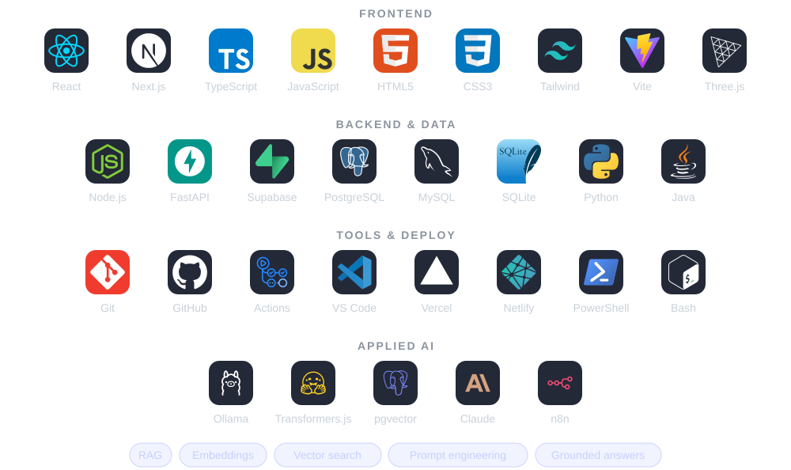

<!-- Animated SVGs in ./assets are generated; effects are inspired by React Bits (Aurora, Dot Grid, Star Border, Rotating Text, Logo Loop) and Vanta (NET) -->

  
  
  
  

## 👋 About me

**Full-Stack Developer Intern at Nexvia Technologies** · Bengaluru

I build **product-focused web apps** with React, Next.js, TypeScript and Supabase, and add AI where it genuinely helps. My strongest project is **Groundwork**: a private RAG assistant that answers from your PDFs and cites the exact page, with retrieval, embeddings and pgvector search written from scratch in TypeScript.

My path into development runs through two years of **tech support and IT recruitment**. Working with users and hiring teams taught me to turn vague requests into clear requirements, stay calm under pressure, and explain technical work to anyone — and I bring that to every feature I ship.

- 🎯 **Focus** — product UIs · full-stack apps · RAG and AI features
- 🎓 **Education** — B.Tech CSE · MCA (pursuing, Amity Online)

## 🚀 Featured projects

  
  

  
  

  
  

  Source: <a href="https://github.com/Adarsh619/RAG-Knowledge-Assistant">Groundwork</a> · <a href="https://github.com/Adarsh619/Development-projects/tree/main/aizen-map">Aizen Map</a> · <a href="https://github.com/Adarsh619/Development-projects/tree/main/Personal-Finance-Dashboard">FinanceFlow</a> · <a href="https://github.com/Adarsh619/Development-projects/tree/main/AI-Prompt-Lab">PromptLab</a> · <a href="https://github.com/Adarsh619/my-portfolio">Portfolio</a> · <a href="https://github.com/Adarsh619/Development-projects/tree/main/calorie-tracker">Calorie Track</a>

## 🛠️ Tech stack

  <picture>
    <source media="(prefers-color-scheme: light)" srcset="./assets/tech-stack-light.svg" />
    
  </picture>

## 📜 Certifications

- 🏅 **[Claude Code 101](https://academy.claude.com/verify/80f7188902bce1437f772a5087e10941)** — Anthropic Academy · 2026
- 🏅 **[Claude 101](https://academy.claude.com/verify/8bf18b81bd8d56327177dbfdd3f8856d)** — Anthropic Academy · 2026

## 🔭 Right now

- 🔨 **Building:** full-stack features as an intern at Nexvia Technologies; better retrieval, citations and grounded answers in Groundwork; stronger auth and REST APIs across my apps
- 🌱 **Exploring next:** AI agents and tool calling, n8n workflow automation, CI/CD and cloud deployment
- 💼 **Looking for:** Frontend, Full-Stack or AI-integrated development roles — Bengaluru or remote

<b>💼 Experience & education</b>

 

| Role | Where | When |
| --- | --- | --- |
| **Full-Stack Developer Intern** | Nexvia Technologies | Oct 2026 – Present |
| IT Recruiter | BlueRose Technologies | Jul 2026 – Sep 2026 |
| Associate Staffing Specialist | FirstMeridian Global Services | Sep 2025 – Jul 2026 |
| CRM / Technical Support | Altruist Technologies | Mar 2024 – Jan 2025 |

- 🎓 **MCA** — Amity University Online (2026 – 2028, pursuing)
- 🎓 **B.Tech, Computer Science & Engineering** — Pydah College of Engineering & Technology (2017 – 2021)

<b>🤖 How I work with AI tools</b>

 

I use `Claude Code` · `Cursor` · `OpenAI Codex` · `ChatGPT` for research, debugging, code review and faster iteration — as assistants, not substitutes. I make sure I understand the architecture, data flow and decisions behind everything I ship.

 

<!-- <picture> keeps GitHub from turning the footer into a link -->
<picture></picture>
