<!-- Animated SVGs in ./assets are generated; effects are inspired by React Bits (Aurora, Dot Grid, Star Border, Rotating Text, Logo Loop) and Vanta (NET) -->
<a href="https://adarsh619.github.io/my-portfolio/">
  
</a>

  
  
  
  <a href="https://aizenmap.netlify.app/"></a>

## 👋 About me

**Full-Stack Developer Intern at Nexvia Technologies** · Bengaluru

I build **SaaS platforms, marketplaces and AI-powered apps** with TypeScript, React, Next.js, Node.js and PostgreSQL, and I take them from database design to deployment. At Nexvia I've shipped two live platforms: **TaskFlow**, a multi-tenant project management SaaS, and **ShopSphere**, a multi-vendor marketplace, with **513 automated tests** between them. Outside work I'm building **PaperWeave**, an AI research assistant; earlier projects include **Groundwork**, a PDF assistant that cites its pages, and **Aizen Map**, live on Netlify.

My path into development runs through two years of **tech support and IT recruitment**. Working with users and hiring teams taught me to turn vague requests into clear requirements, stay calm under pressure, and explain technical work to anyone — and I bring that to every feature I ship.

- 🎯 **Focus** — SaaS platforms · marketplaces · AI-powered apps
- 🎓 **Education** — B.Tech CSE · MCA (pursuing, Amity Online)


## 🚀 Featured projects

  <a href="https://taskflow-fs04.onrender.com"></a>
  <a href="https://shopsphere-fs01.vercel.app"></a>

  <a href="https://github.com/Adarsh619/RAG-Knowledge-Assistant"></a>
  <a href="https://github.com/Adarsh619/Development-projects/tree/main/Personal-Finance-Dashboard"></a>

  <a href="https://adarsh619.github.io/my-portfolio/"></a>
  <a href="https://aizenmap.netlify.app/"></a>

  <a href="https://github.com/Adarsh619/Development-projects/tree/main/AI-Prompt-Lab"></a>
  <a href="https://github.com/Adarsh619/Development-projects/tree/main/calorie-tracker"></a>

  Source: <a href="https://github.com/Adarsh619/Rout_Adarsh_Pradhan_Capstone_Projects/tree/main/FS-04">TaskFlow</a> · <a href="https://github.com/Adarsh619/Rout_Adarsh_Pradhan_Capstone_Projects/tree/main/FS-01">ShopSphere</a> · <a href="https://github.com/Adarsh619/RAG-Knowledge-Assistant">Groundwork</a> · <a href="https://github.com/Adarsh619/Development-projects/tree/main/Personal-Finance-Dashboard">FinanceFlow</a> · <a href="https://github.com/Adarsh619/my-portfolio">Portfolio</a> · <a href="https://github.com/Adarsh619/Development-projects/tree/main/aizen-map">Aizen Map</a> · <a href="https://github.com/Adarsh619/Development-projects/tree/main/AI-Prompt-Lab">PromptLab</a> · <a href="https://github.com/Adarsh619/Development-projects/tree/main/calorie-tracker">Calorie Track</a>

## 🛠️ Tech stack

  <picture>
    <source media="(prefers-color-scheme: light)" srcset="./assets/tech-stack-light.svg" />
    
  </picture>

## 📜 Certifications

- 🏅 **Claude Code in Action** — Anthropic Academy · 2026
- 🏅 **[Claude Code 101](https://academy.claude.com/verify/80f7188902bce1437f772a5087e10941)** — Anthropic Academy · 2026
- 🏅 **[Claude 101](https://academy.claude.com/verify/8bf18b81bd8d56327177dbfdd3f8856d)** — Anthropic Academy · 2026

## 🔭 Right now

- 🔨 **Building:** [PaperWeave](https://github.com/Adarsh619/paperweave), an agentic GraphRAG assistant that answers AI-research questions from a 500-paper knowledge graph, with citations (FastAPI · LangGraph · Neo4j · Qdrant · Next.js)
- 🌱 **Exploring next:** AI agents and tool calling, n8n workflow automation, CI/CD and cloud deployment
- 💼 **Looking for:** Full-stack developer roles — Bengaluru or remote

<b>💼 Experience & education</b>

 

| Role | Where | When |
| --- | --- | --- |
| **Full-Stack Developer Intern** | Nexvia Technologies | Oct 2026 – Present |
| IT Recruiter | BlueRose Technologies | Jul 2026 – Sep 2026 |
| Associate Staffing Specialist | FirstMeridian Global Services | Sep 2025 – Jul 2026 |
| CRM / Technical Support | Altruist Technologies | Mar 2024 – Jan 2025 |

**At Nexvia** I shipped two live platforms: [TaskFlow](https://taskflow-fs04.onrender.com), a multi-tenant SaaS project management platform with Django, React, Celery and Stripe billing, and [ShopSphere](https://shopsphere-fs01.vercel.app), a multi-vendor marketplace with split payments on Node.js, PostgreSQL and Elasticsearch. Both have CI/CD pipelines and 513 automated tests between them.

- 🎓 **MCA** — Amity University Online (2026 – 2028, pursuing)
- 🎓 **B.Tech, Computer Science & Engineering** — Pydah College of Engineering & Technology (2017 – 2021)

<b>🤖 How I work with AI tools</b>

 

I use `Claude Code` · `Cursor` · `OpenAI Codex` · `ChatGPT` for research, debugging, code review and faster iteration — as assistants, not substitutes. I make sure I understand the architecture, data flow and decisions behind everything I ship.

 

<!-- <picture> keeps GitHub from turning the footer into a link -->
<picture></picture>
