<!-- Animated SVGs in ./assets are generated; effects are inspired by React Bits (Aurora, Dot Grid, Star Border, Rotating Text, Logo Loop) -->

  
  
  
  

## 👋 About me

I build web apps that are **fast, clear and easy to use**, and I wire practical AI into them. My favourite so far is **Groundwork**: a private assistant that answers questions from your own PDFs and shows the exact page each answer came from — with the whole RAG pipeline written in TypeScript, running on a local model.

Before coding full-time I worked in **tech support and IT recruitment**, so I'm used to understanding what people actually need and explaining things clearly. I hold a **B.Tech in Computer Science** and I'm now doing my **MCA**.

## 🚀 Featured projects

  
  

  
  

  
  

  Source: <a href="https://github.com/Adarsh619/RAG-Knowledge-Assistant">Groundwork</a> · <a href="https://github.com/Adarsh619/Development-projects/tree/main/aizen-map">Aizen Map</a> · <a href="https://github.com/Adarsh619/Development-projects/tree/main/Personal-Finance-Dashboard">FinanceFlow</a> · <a href="https://github.com/Adarsh619/Development-projects/tree/main/AI-Prompt-Lab">PromptLab</a> · <a href="https://github.com/Adarsh619/my-portfolio">Portfolio</a> · <a href="https://github.com/Adarsh619/Development-projects/tree/main/calorie-tracker">Calorie Track</a>

## 🛠️ Tech stack

  <b>FRONTEND</b> 
  

  <b>BACKEND & DATA</b> 
  

  <b>TOOLS & DEPLOY</b> 
  

  <b>APPLIED AI</b> 
  
  
  
  
  

## 🔭 Right now

- 🔨 **Building:** better retrieval, citations and grounded answers in Groundwork; stronger auth and REST APIs across my apps
- 🌱 **Exploring next:** AI agents and tool calling, n8n workflow automation, CI/CD and cloud deployment
- 💼 **Looking for:** Frontend, Full-Stack or AI-integrated development roles — Bengaluru or remote

<b>💼 Experience & education</b>

 

| Role | Where | When |
| --- | --- | --- |
| IT Recruiter | BlueRose Technologies | Jul 2026 – Sep 2026 |
| Associate Staffing Specialist | FirstMeridian Global Services | Sep 2025 – Jul 2026 |
| CRM / Technical Support | Altruist Technologies | Mar 2024 – Jan 2025 |

- 🎓 **MCA** — Amity University Online (2026 – 2028, pursuing)
- 🎓 **B.Tech, Computer Science & Engineering** — Pydah College of Engineering & Technology (2017 – 2021)
- 📜 **Claude 101** — Anthropic Academy (2026)

<b>🤖 How I work with AI tools</b>

 

I use `Claude Code` · `Cursor` · `OpenAI Codex` · `ChatGPT` for research, debugging, code review and faster iteration — as assistants, not substitutes. I make sure I understand the architecture, data flow and decisions behind everything I ship.

 

